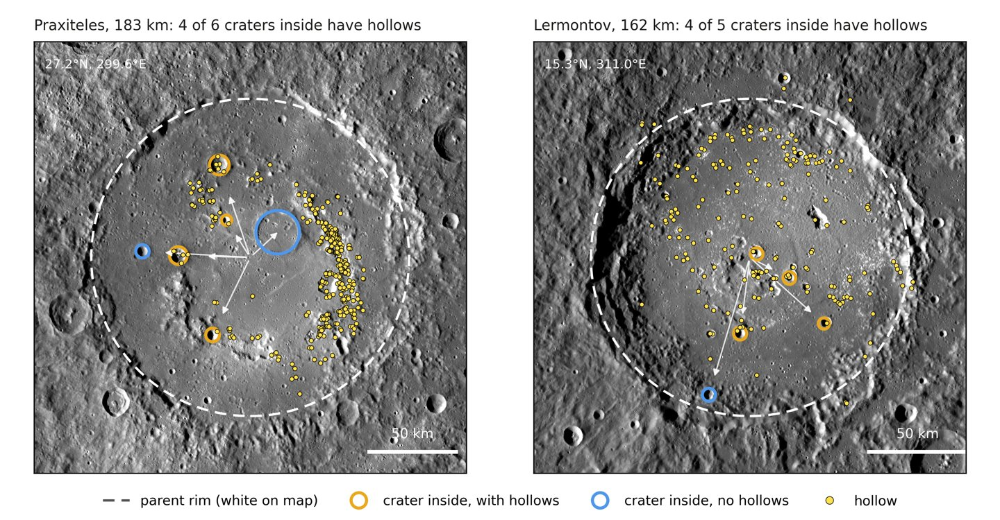

# Mercury crater graph and hollows

[](https://doi.org/10.5281/zenodo.23779916)

**Interactive explorer:** https://michael-s-phillips.github.io/mercury-crater-graph/

This project builds a directed graph of Mercury's impact craters in which every edge records that one crater formed inside an older crater or basin, and it places the hollows of Mercury on that graph. Nodes are the 31,571 craters ≥ 5 km in the Herrick et al. (2018) catalog and 53 basins from Orgel et al. (2020). An edge `A → B` means crater B formed after A because B's center lies inside A's rim and A is at least twice B's diameter. The graph links 14,933 craters to the feature they formed inside, and its longest chain holds four features.

The graph exists to test where hollows form. A crater that forms inside an older crater excavates and uplifts material that the older crater already brought up, so the graph asks whether craters inside older craters host hollows more often, and whether the depth they reach matters. The 6,731 hollows are the deep-learning detections of Bickel et al. (2025), recomputed with the MESSENGER camera model and merged into one entry per hollow.

An interactive map explorer comes with the data. Clicking a crater shows its stratigraphic column (the features it formed inside, below, and the longest chain of craters inside it, above), its hollows, its position in its parent, and a first-order depth of origin. The explorer is plain HTML and JavaScript with no server or account. Open `explorer/index.html` from disk, use the GitHub Pages site, or share `dist/mercury_crater_graph_explorer.html`, a single 3.5 MB file with the data built in. The full explorer draws a tiled basemap: the MESSENGER MDIS monochrome global mosaic down to 333 m/pixel, or the MDIS enhanced-color mosaic down to 665 m/pixel, in which low-reflectance material appears dark blue.



## Results

| Quantity | Value |
|---|---|
| Craters in the catalog (≥ 5 km) | 31,571 |
| Basins added (Orgel et al., certain or probable, duplicates removed) | 53 |
| Craters inside a crater or basin at least twice their size | 14,933 (47%) |
| Of those, on the parent's wall, floor, peak | 9,788, 4,565, 563 (17 possible peak rings left out) |
| Longest chain | 4 features (71 craters have three ancestors) |
| Hollows | 6,731 |
| Craters with hollows inside 0.9 radii | 608 |

Craters that formed inside an older crater or basin host hollows 1.85 (1.54–2.22) times as often (odds) as isolated craters of the same size, latitude, imaging completeness, northern-plains setting, modeled temperature contrast ΔT, and regional hosting rate. Craters inside a parent crater that has hollows host hollows 2.39 (1.73–3.29) times as often as craters inside parents without hollows. Within the same parent, craters on the peak or floor host hollows no more often than craters on the wall (1.23, 0.89–1.70; p = 0.20), and the summed depth of excavation and uplift predicts hosting worse than a crater's own excavation depth. Nesting therefore matters, and the depth a crater reaches by forming inside another does not. The records in `outputs/` hold every fit.

## How relations are inferred

**Containment.** A crater whose center lies inside a crater or basin at least twice its diameter formed after it, because the larger impact would have erased an earlier crater inside its rim. These edges are treated as certain. Each crater's parent is the smallest feature that contains it, so the graph is a forest of trees rooted in craters and basins that lie inside nothing larger. Seventeen large, nearly concentric nested circles with ring-like diameter ratios are flagged as possible peak rings.

**Rim overlaps are not ordered.** The Mars version of this graph (Phillips, 2026, doi:10.5281/zenodo.23675713) orients overlapping rims with the rim-arc completeness recorded in the Mars catalog and with rim continuity on MOLA topography. The Herrick catalog records no rim-arc completeness, so a crater that cuts a parent's rim without its center lying inside counts here as isolated.

**Basins.** Orgel et al. (2020) basins rated certain or probable are added as nodes. Twenty-seven duplicate cataloged craters (centers within 0.15 radii, diameters within a factor of 1.43) and fourteen suggested basins are left out.

**Position in the parent.** The child's center distance in parent radii, ρ, places it on the parent's peak (ρ < 0.2), floor (0.2–0.6), or wall (≥ 0.6). A parent ≤ 12 km across is simple and has no peak.

**Depth of origin.** The deepest pre-impact level a crater exposes is z_max = z_base + max(0.1 D_tc, 0.086 D^1.03), where D_tc = D_sc^0.15 D^0.85 is the transient diameter for D_sc = 12 km (Croft, 1985), 0.086 D^1.03 is the stratigraphic uplift of a complex crater (Cintala and Grieve, 1998), and z_base is the depth of origin of the parent's surface where the child formed: the parent's own z_base plus its uplift on the peak, plus its excavation depth on the floor, and plus nothing on the wall. A child on a filled floor must first cut through the fill, estimated from the depth deficit against fresh craters (or 3.0 km for Caloris; Ernst et al., 2015). These are first-order scalings and are reported as such.

**Hollow hosting.** Hollows are assigned to the smallest cataloged crater whose 1.1 radii contain them. A crater has hollows when at least one assigned hollow lies inside 0.9 of its radius, so hollows on a parent's surface just outside a child's rim do not count for the child.

## Outputs

| File | Contents |
|---|---|
| `outputs/crater_dag_nodes.csv.gz` | All 31,624 craters and basins with catalog attributes, parent, position in parent, chain depth, depth-of-origin terms, fill estimate, completeness, plains flag, ΔT, and assigned hollows |
| `outputs/edges.csv` | One row per containment relation: `older_id`, `younger_id`, diameters, ρ, and position |
| `outputs/crater_dag_record.json` | Graph statistics and the depth-of-origin fits |
| `outputs/crater_dag_tests_record.json` | Nesting, position, chain, parent type, inheritance, and within-parent tests |
| `outputs/crater_dag_sens_record.json` | Sensitivity of the nesting and inheritance results, and the matched comparison within 300 km |
| `figures/fig_nested_examples.png`, `.pdf` | Praxiteles and Lermontov with the craters inside them and their hollows |
| `explorer/index.html`, `explorer/data/` | The interactive explorer and its data (`mcg_data.js` loads from disk) |
| `explorer/tiles/` | Basemap tiles, `mdis/` (levels 0–4) and `color/` (levels 0–3); on the `gh-pages` branch only |
| `dist/mercury_crater_graph_explorer.html` | Single-file explorer with the data and a coarse basemap inlined |
| `index.html`, `.nojekyll` | Redirect to `explorer/` for GitHub Pages |

## Running the pipeline

The pipeline needs Python 3.10 or later with the packages in `requirements.txt`. All inputs are in `inputs/` (see `inputs/README.md`); the basemap tiles and the example figure also need the MESSENGER MDIS global mosaics from the USGS Astrogeology Science Center.

```bash
python scripts/crater_dag.py                 # graph, depth of origin, covariates, main fits -> outputs/
python scripts/crater_dag_tests.py           # nesting, position, inheritance, within-parent tests
python scripts/crater_dag_sens.py            # sensitivity and matched comparison
python scripts/export_explorer.py            # explorer/data/*.json
python scripts/make_tiles.py Mercury_MESSENGER_MDIS_Basemap_BDR_Mosaic_Global_166m.tif explorer/tiles/mdis --top 4
python scripts/make_tiles.py x explorer/tiles/mdis --pyramid 4
python scripts/make_tiles.py Mercury_MESSENGER_MDIS_Basemap_EnhancedColor_Mosaic_Global_665m.tif explorer/tiles/color --top 3
python scripts/make_tiles.py x explorer/tiles/color --pyramid 3
python scripts/build_public_explorer.py --repo https://github.com/Michael-S-Phillips/mercury-crater-graph \
    --tiles-url https://michael-s-phillips.github.io/mercury-crater-graph/explorer/tiles [--doi <Zenodo DOI>]
python scripts/make_figures.py Mercury_MESSENGER_MDIS_Basemap_BDR_Mosaic_Global_166m.tif
```

The three analysis scripts reproduce the records in `outputs/` to floating-point precision (differences of order 1e-5 relative or smaller across numpy/scipy/statsmodels versions). The graph and tests take about a minute on a laptop; the tiles take about a minute from local mosaics.

## Publishing

**Explorer.** The website is served by GitHub Pages from the `gh-pages` branch, which holds `index.html`, `.nojekyll`, `explorer/index.html`, `explorer/data/`, and the tiles (about 330 MB). The main branch carries no tiles. Rerun `build_public_explorer.py` with `--doi` once the Zenodo DOI exists, so the page footer and the single-file build cite it.

**Data.** `.zenodo.json` and `CITATION.cff` hold the deposit metadata. If the repository is linked to Zenodo, each GitHub release is archived with its own DOI. The code is under the MIT License (`LICENSE`) and the data products under CC BY 4.0 (`LICENSE-DATA.md`). The outputs redistribute fields from the Herrick et al. (2018) catalog, the Orgel et al. (2020) basins, and the Bickel et al. (2025) hollow catalog, so the record credits them.

## Limitations

**Containment only.** Craters that cut a parent's rim are counted as isolated, so the graph undercounts nesting near rims.

**Catalog limits.** The Herrick catalog starts at 5 km and records preservation class only for craters ≥ 10 km. Smaller craters inside larger ones are not linked.

**Imaging.** MESSENGER imaged known hollow sites at high resolution, so craters inside hollow-bearing parents may be better imaged than the completeness at their centers captures. The nesting result holds for craters with completeness ≥ 0.5.

**Depth model.** The uplift scaling comes from terrestrial craters, the position limits are fixed, and fill thickness in basins other than Caloris is unknown.

## Data sources

- Herrick, R. R., Bateman, E. M., Crumpacker, W. G., and Bates, D. (2018). Observations from a global database of impact craters on Mercury with diameters greater than 5 km. *Journal of Geophysical Research: Planets*, 123, 2089–2109. doi:10.1029/2017JE005516
- Orgel, C., Fassett, C. I., Michael, G., Riedel, C., van der Bogert, C. H., and Hiesinger, H. (2020). Re-examination of the population, stratigraphy, and sequence of Mercurian basins. *Journal of Geophysical Research: Planets*, 125, e2019JE006212. doi:10.1029/2019JE006212
- Bickel, V. T., Deutsch, A. N., and Blewett, D. T. (2025). Hollows on Mercury: Creation and analysis of a global reference catalog with deep learning. *Journal of Geophysical Research: Machine Learning and Computation*, 2, e2024JH000431. doi:10.1029/2024JH000431
- Denevi, B. W., et al. (2018). Calibration, projection, and final image products of MESSENGER's Mercury Dual Imaging System. *Space Science Reviews*, 214, 2. doi:10.1007/s11214-017-0440-y
- Becker, K. J., et al. (2016). First global digital elevation model of Mercury. 47th Lunar and Planetary Science Conference, abstract 2959.
- Croft, S. K. (1985). The scaling of complex craters. *Journal of Geophysical Research*, 90, C828–C842.
- Cintala, M. J., and Grieve, R. A. F. (1998). Scaling impact melting and crater dimensions: Implications for the lunar cratering record. *Meteoritics & Planetary Science*, 33, 889–912.
- Ernst, C. M., et al. (2015). Stratigraphy of the Caloris basin, Mercury: Implications for volcanic history and basin impact melt. *Icarus*, 250, 413–429.
